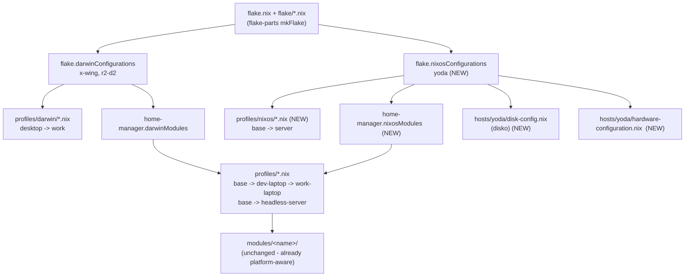

# Plan: convert yoda (Intel NUC 10) from Ubuntu + standalone HM to NixOS

Status: proposed, not implemented.
Date: 2026-10-18.

## Context

yoda is the Intel NUC 10 Performance kit (`BXNUC10i7FNH3` / `NUC10FNH`,
i7-10710U Comet Lake-U, 6C/12T) on the LAN at `192.168.1.40`. Its M.2 2280
NVMe has died and is being replaced. Nothing on the old disk needs
recovering.

Today yoda is Ubuntu with a **standalone home-manager** configuration
(`flake.homeConfigurations."phamann@yoda"`, see `flake/hosts.nix`). That was
deliberate — D1 in `plans/refactor-nix-structure.md`. The dead disk forces a
fresh install anyway, which removes the only real reason that decision stood:
there is no existing OS worth preserving.

The target is a full `nixosConfigurations.yoda` with home-manager as a NixOS
module, mirroring exactly how the Macs already work
(`darwinModules.home-manager` in `flake/hosts.nix`).

Roles the machine serves:

- local development / hacking over SSH (what `profiles/headless-server.nix`
  already covers)
- home-automation Docker containers

---

## Order of operations — start here

The two halves of this document are **not** independent, and the repo work
comes first: `nixos-anywhere --flake .#yoda` can only install a configuration
that already exists. So the sequence is:

| #   | Step                                        | Where         | Blocks on |
| --- | ------------------------------------------- | ------------- | --------- |
| 1   | Fit the new NVMe                            | NUC, physical | —         |
| 2   | BIOS: Secure Boot off, USB first in boot order | NUC, physical | 1      |
| 3   | Flash the installer USB                     | Mac           | —         |
| 4   | Make the repo changes (Part 1, D1–D11)      | Mac           | —         |
| 5   | `git add` the new files                     | Mac           | 4         |
| 6   | Boot the NUC from USB, set a password, note the IP | NUC, physical | 1,2,3 |
| 7   | Run `nixos-anywhere`                        | Mac → NUC     | 4,5,6     |
| 8   | Commit the generated `hardware-configuration.nix`, push | Mac | 7    |
| 9   | Update docs + the host-identification note  | Mac           | 8         |

Steps 3 and 4 are independent — flash the USB while the repo work is in
flight, or vice versa. Everything else is strictly ordered.

Three things that will bite if you skip them:

- **Step 5 is not optional.** Nix flakes only see files that git knows about.
  A brand-new `hosts/yoda/configuration.nix` that is untracked is *invisible*
  to `nix build` / `nixos-anywhere`, and you get a baffling "path does not
  exist" or "attribute 'yoda' missing". `git add` is enough — you don't have
  to commit.
- **Commit the placeholder `hardware-configuration.nix` (D7) before step 7.**
  The flake has to evaluate before nixos-anywhere can build the disko script,
  and it can't evaluate with a missing import. `--generate-hardware-config`
  then overwrites the placeholder with the real thing during the run.
- **You cannot verify any of this on the Mac.** `nix flake check` on darwin
  skips `checks.x86_64-linux.*`. Push the branch and let the ubuntu-24.04 CI
  job build it, or accept that step 7 is where you find out.

---

## Part 1 — repo changes

### Layer diagram after the change



The HM side is reused wholesale. `profiles/headless-server.nix` and every
`modules/<name>` stay as they are.

---

### D1 — flake inputs

Add three inputs to `flake.nix`.

```nix
# NixOS hosts track the nixos-<release> channel, NOT nixpkgs-<release>-darwin.
# The darwin branch only advances when the darwin Hydra jobset is green and is
# never gated on the NixOS installer / systemd / kernel tests. Both branches
# exist for 26.05 and sit at different revisions.
nixpkgs-nixos.url = "github:nixos/nixpkgs/nixos-26.05";

# Declarative disk partitioning. Consumed as a NixOS module + by
# nixos-anywhere during the install (see Part 2).
disko = {
  url = "github:nix-community/disko";
  inputs.nixpkgs.follows = "nixpkgs-nixos";
};

# Per-model hardware quirks. No NUC10 module upstream (only 5i5ryb,
# 7i3bnb, 8i7beh, 12wshi7) — we use the generic Intel + SSD modules.
nixos-hardware.url = "github:NixOS/nixos-hardware";

# Determinate Nix, to match the Macs (which run it via the .pkg installer,
# with `nix.enable = false` in profiles/darwin/system.nix telling nix-darwin
# to keep its hands off the daemon).
#
# DELIBERATELY NOT `inputs.nixpkgs.follows` — unlike every other input in
# this flake. Upstream specifically warns that following nixpkgs here causes
# FlakeHub Cache misses, because the artifacts are built against their
# pinned nixpkgs. Overriding it means rebuilding Nix itself from source.
determinate.url = "https://flakehub.com/f/DeterminateSystems/determinate/3";
```

Note that input is a **FlakeHub** URL, not a `github:` one — it's the only
such input in the flake, and `nix flake update` will reach flakehub.com for
it.

**Why a second nixpkgs and not just reuse the existing one?** Mechanically
the darwin branch _would_ build a NixOS system — it's the same release, same
packages. The difference is gating: `nixpkgs-26.05-darwin` advances on darwin
test results only. Running a machine that must boot, mount and network itself
off a channel whose NixOS tests were never consulted is the kind of thing that
is fine 99 times and ruins a Sunday on the 100th. The cost is one extra
`flake.lock` entry.

`home-manager` keeps `inputs.nixpkgs.follows = "nixpkgs"`. With
`useGlobalPkgs = true` HM reuses the system's pkgs anyway, so the `follows`
only governs HM's own module code — and both branches are 26.05, so the
release tier matches either way.

### D2 — extract the overlay list (`lib/overlays.nix`, new)

`flake.nix` currently builds the overlay list inline inside `perSystem`.
`mkNixos` needs the same overlays (`pkgs.unstable.*` is used across
`modules/packages/*`), so it has to move somewhere both can reach.

```nix
# lib/overlays.nix
{ inputs, lib }:
system:
[
  # `pkgs.unstable.<name>` for packages ahead of the release channel.
  (_: _: {
    unstable = import inputs.nixpkgs-unstable {
      inherit system;
      config.allowUnfree = true;
    };
  })
  inputs.rust-overlay.overlays.default
]
# checkPhase skips for packages whose test suites fail on aarch64-darwin.
# These are darwin-specific breakages — don't pay for them on linux.
++ lib.optionals (lib.hasSuffix "-darwin" system) [
  (_: prev: {
    coredns = prev.coredns.overrideAttrs (_: {
      doCheck = false;
      doInstallCheck = false;
    });
    open-policy-agent = prev.open-policy-agent.overrideAttrs (_: { doCheck = false; });
    direnv = prev.direnv.overrideAttrs (_: { doCheck = false; });
  })
];
```

Note the darwin gate: those three overrides exist because of upstream test
failures on aarch64-darwin (see the `nixpkgs_darwin_test_failures` note).
Applying them on x86_64-linux would silently disable test suites that pass
there and, worse, would force local rebuilds of three packages that would
otherwise substitute straight from cache.nixos.org.

`flake.nix`'s `perSystem` then becomes:

```nix
overlays = import ./lib/overlays.nix { inherit inputs; inherit (inputs.nixpkgs) lib; } system;
```

### D3 — `flake/hosts.nix`: add `mkNixos`

```nix
mkNixos =
  {
    host,
    system,
    user,
  }:
  inputs.nixpkgs-nixos.lib.nixosSystem {
    specialArgs = { inherit inputs system; };
    modules = [
      (../hosts + "/${host}/configuration.nix")
      inputs.disko.nixosModules.disko
      inputs.determinate.nixosModules.default
      inputs.home-manager.nixosModules.home-manager
      {
        nixpkgs = {
          hostPlatform = system;
          config.allowUnfree = true;
          overlays = import ../lib/overlays.nix {
            inherit inputs;
            inherit (inputs.nixpkgs-nixos) lib;
          } system;
        };

        home-manager = {
          useGlobalPkgs = true;
          useUserPackages = true;
          backupFileExtension = "hm-backup";
          users.${user}.imports = [ (../hosts + "/${host}/home.nix") ];
          extraSpecialArgs = { inherit inputs system; };
        };
      }
    ];
  };
```

and:

```nix
flake.nixosConfigurations.yoda = mkNixos {
  host = "yoda";
  system = "x86_64-linux";
  user = "phamann";
};
```

Then **delete** `flake.homeConfigurations."phamann@yoda"` and `mkHomeManager`
— nothing else uses it. (If you'd rather keep a standalone-HM escape hatch for
some future non-NixOS Linux box, leave `mkHomeManager` in place; it costs
nothing but a few lines.)

`mkNixos` deliberately does **not** go through `withSystem`: the flake-parts
`perSystem` pkgs are built from `inputs.nixpkgs` (darwin branch), and yoda
must use `inputs.nixpkgs-nixos`. Building `nixpkgs` inside the module set via
`nixpkgs.hostPlatform` is the current idiom anyway.

### D4 — `profiles/nixos/base.nix` (new)

Mirrors `profiles/darwin/system.nix` in intent: everything every NixOS host
gets, with nothing host-specific.

```nix
{ pkgs, ... }:
{
  # Baseline for any NixOS host in this repo. Hardware, disks and hostname
  # live in hosts/<name>/; role packages live in profiles/nixos/<role>.nix.

  # NOTE: with inputs.determinate.nixosModules.default in the module list
  # (flake/hosts.nix), everything below still applies — the Determinate
  # module redirects NixOS's generated nix.conf to /etc/nix/nix.custom.conf,
  # which determinate-nixd's own /etc/nix/nix.conf includes. It does NOT
  # take `nix.settings` away from you. It does set `nix.package` itself, so
  # don't set that here.
  nix = {
    settings = {
      # Redundant under Determinate Nix (flakes are on by default) but kept
      # so the config still does the right thing if determinate is removed.
      experimental-features = [
        "nix-command"
        "flakes"
      ];
      trusted-users = [
        "root"
        "phamann"
      ];
      auto-optimise-store = true;
      # Build cores: i7-10710U is 6C/12T. Leave headroom for the containers.
      max-jobs = 6;
    };
    gc = {
      automatic = true;
      dates = "weekly";
      options = "--delete-older-than 30d";
    };
  };

  nixpkgs.config.allowUnfree = true;

  boot.loader = {
    systemd-boot = {
      enable = true;
      # Bound the ESP: 1G of /boot fills up fast with 10 kernels.
      configurationLimit = 10;
    };
    efi.canTouchEfiVariables = true;
  };

  time.timeZone = "Europe/London";
  i18n.defaultLocale = "en_GB.UTF-8";

  # Required even though zsh config comes from home-manager: NixOS needs the
  # shell registered in /etc/shells before it's valid as a login shell.
  # Same reason profiles/darwin/system.nix sets it.
  programs.zsh.enable = true;

  users.users.phamann = {
    isNormalUser = true;
    description = "Patrick Hamann";
    extraGroups = [ "wheel" ];
    shell = pkgs.zsh;
    openssh.authorizedKeys.keys = [
      # TODO: paste ~/.ssh/id_ed25519.pub from the Mac.
      "ssh-ed25519 AAAA... phamann"
    ];
  };

  services.openssh = {
    enable = true;
    settings = {
      PasswordAuthentication = false;
      KbdInteractiveAuthentication = false;
      PermitRootLogin = "no";
    };
  };

  networking.firewall.enable = true;

  # Bootstrap only — everything else comes from home-manager.
  environment.systemPackages = [ pkgs.git ];
}
```

### D4b — what the Determinate NixOS module actually does

Upstream's README documents the NixOS install (`nixosModules.default`) but
not its options, so this is read from `modules/nixos.nix` in the determinate
repo:

- `determinate.enable` **defaults to `true`** — importing the module is
  enough, there's no enable flag to set. (Contrast nix-darwin, which needs
  `determinateNix.enable = true`.)
- Sets `nix.package` to Determinate's Nix build. **Don't set `nix.package`
  yourself** — that's the one option that would collide.
- Retargets `environment.etc."nix/nix.conf"` to `nix/nix.custom.conf`, which
  determinate-nixd's own `/etc/nix/nix.conf` includes. **This is why
  `nix.settings` keeps working** — your settings land in the custom file
  rather than being ignored.
- Replaces the `nix-daemon.service` `ExecStart` with `determinate-nixd`, and
  adds a `determinate-nixd.socket` unit.
- Repoints the `nixpkgs` flake registry entry at FlakeHub's `nixpkgs-weekly`
  (at `mkOverride 750`, so a local `nix.registry.nixpkgs.flake` still wins).
  Worth knowing: a bare `nix shell nixpkgs#foo` on yoda resolves differently
  than on a stock NixOS box.
- `nix.gc` is **untouched** by this module, so the stock NixOS GC timer in
  `base.nix` still runs. Determinate Nix also has its own GC behaviour; if
  they turn out to overlap, drop the `nix.gc` block rather than fighting it.

There is **no `nix.enable = false`** on the NixOS side. That setting is
nix-darwin/home-manager only — on the Macs it exists because Determinate is
installed out-of-band by the `.pkg` installer and nix-darwin must not fight
it. On NixOS the module *is* the install, and it needs the stock nix module
active to generate the config it redirects.

### D5 — `profiles/nixos/server.nix` (new)

```nix
{ ... }:
{
  # Headless always-on box: containers, no desktop, no suspend.
  imports = [ ./base.nix ];

  virtualisation.docker = {
    enable = true;
    # Containers survive a daemon restart (incl. a nixos-rebuild that bumps
    # the docker package) instead of all going down at once.
    daemon.settings.live-restore = true;
    autoPrune = {
      enable = true;
      dates = "weekly";
    };
  };
  users.users.phamann.extraGroups = [ "docker" ];

  # Intel thermal management — the NUC's chassis is small and the 10710U
  # will throttle hard without it.
  services.thermald.enable = true;
  powerManagement.cpuFreqGovernor = "schedutil";

  # BIOS/firmware updates without booting anything else.
  services.fwupd.enable = true;

  # Compressed RAM swap instead of a swap partition — better for an SSD and
  # removes a disko partition we'd otherwise have to size.
  zramSwap.enable = true;

  # Headless: never sleep because nothing is on the console.
  services.logind.lidSwitch = "ignore";
  systemd.sleep.extraConfig = ''
    AllowSuspend=no
    AllowHibernation=no
  '';
}
```

### D6 — `hosts/yoda/disk-config.nix` (new)

```nix
{ ... }:
{
  # Single M.2 2280 NVMe, GPT + UEFI. The NUC10FNH also has a 2.5" SATA
  # bay — add a second `disk.bulk` entry here if/when it's populated.
  #
  # Verify the device path on the installer before running: `lsblk`.
  # /dev/nvme0n1 is right for a single-NVMe NUC, but disko ZAPS whatever
  # you name here.
  disko.devices.disk.main = {
    device = "/dev/nvme0n1";
    type = "disk";
    content = {
      type = "gpt";
      partitions = {
        ESP = {
          priority = 1;
          size = "1G";
          type = "EF00";
          content = {
            type = "filesystem";
            format = "vfat";
            mountpoint = "/boot";
            mountOptions = [ "umask=0077" ];
          };
        };
        root = {
          size = "100%";
          content = {
            type = "filesystem";
            format = "ext4";
            mountpoint = "/";
          };
        };
      };
    };
  };
}
```

**ext4 over btrfs, deliberately.** btrfs buys snapshots and subvolumes, but
Docker on btrfs uses the `btrfs` storage driver rather than `overlay2`, which
is the far better-trodden path for a container host. For a box whose stated
job is "run home-automation containers", overlay2-on-ext4 is the boring
correct answer. If you want snapshots, say so and this becomes a btrfs layout
with `@`/`@home`/`@nix` subvolumes and `compress=zstd` — it's a 20-line swap,
not a redesign.

**No swap partition** — `zramSwap.enable` in `server.nix` covers it.

### D7 — `hosts/yoda/hardware-configuration.nix` (new, generated)

Generated on the machine during the install (see Part 2) and committed.
For a NUC10 it will be approximately:

```nix
{ config, lib, modulesPath, ... }:
{
  imports = [ (modulesPath + "/installer/scan/not-detected.nix") ];

  boot.initrd.availableKernelModules = [
    "xhci_pci"
    "thunderbolt"
    "nvme"
    "usb_storage"
    "sd_mod"
    "rtsx_pci_sdmmc"
  ];
  boot.kernelModules = [ "kvm-intel" ];

  # fileSystems/swapDevices are supplied by disko — do NOT let
  # nixos-generate-config's versions land here as well or you get
  # duplicate definitions.

  networking.useDHCP = lib.mkDefault true;
  nixpkgs.hostPlatform = lib.mkDefault "x86_64-linux";
  hardware.cpu.intel.updateMicrocode =
    lib.mkDefault config.hardware.enableRedistributableFirmware;
}
```

The `--generate-hardware-config` flag in nixos-anywhere knows to omit
filesystems when disko is in play, but check the generated file before
committing.

### D8 — `hosts/yoda/configuration.nix` (new)

```nix
{ inputs, ... }:
{
  imports = [
    ../../profiles/nixos/server.nix
    ./disk-config.nix
    ./hardware-configuration.nix

    # No NUC10 module exists upstream. `common-cpu-intel-cpu-only` is just
    # `hardware.cpu.intel.updateMicrocode`; `common-cpu-intel` additionally
    # pulls the whole Intel GPU stack (VAAPI, compute runtime, media
    # runtime) — unnecessary closure on a headless box.
    #
    # Switch to `common-cpu-intel` if you ever want QuickSync hardware
    # transcoding in a container (Frigate, Plex, Jellyfin) — the UHD
    # graphics in the 10710U does support it.
    inputs.nixos-hardware.nixosModules.common-cpu-intel-cpu-only
    inputs.nixos-hardware.nixosModules.common-pc-ssd
  ];

  networking.hostName = "yoda";

  # Fresh install — matches the nixpkgs release installed from.
  system.stateVersion = "26.05";
}
```

Note: `common-gpu-intel-comet-lake` is **deprecated** upstream (points at
`common-cpu-intel`), so don't reach for it despite the CPU being Comet Lake.

### D9 — `hosts/yoda/home.nix` (unchanged)

```nix
_: {
  imports = [ ../../profiles/headless-server.nix ];
  modules.theme.scheme = "base24-catppuccin-frappe";
}
```

Genuinely no change. `profiles/base.nix` already derives `/home/phamann` from
`isDarwin`, `modules/gpg` already gates `pinentry` on `isLinux`, `modules/zsh`
already keeps the colima `DOCKER_HOST` behind `mkIf isDarwin` (native Docker
on NixOS needs no `DOCKER_HOST`), and `modules/theme` imports
`stylix.homeModules.stylix` itself so it needs no system-level stylix.

Leave `home.stateVersion = "22.11"` in `profiles/base.nix` alone — it governs
HM module behaviour, is shared with the Macs, and changing it is a separate
decision.

### D10 — `flake/checks.nix`

```nix
// lib.optionalAttrs (system == "x86_64-linux") {
  eval-yoda = self.nixosConfigurations.yoda.config.system.build.toplevel;
}
```

This makes CI materially stronger: the Linux runner now builds the whole
system closure (kernel, systemd, docker, HM) rather than just an HM activation
package. It will also make that job noticeably slower on first run. Everything
substitutes from cache.nixos.org, so it's download-bound, not compile-bound.

### D11 — `Makefile`

```make
.PHONY: yoda
yoda: ## Rebuild yoda (NixOS, x86_64-linux) — run ON yoda
	sudo nixos-rebuild switch --flake ~/.config/nixpkgs#yoda

.PHONY: yoda-remote
yoda-remote: ## Rebuild yoda from a Mac, building on yoda itself
	nixos-rebuild switch --flake ~/.config/nixpkgs#yoda \
		--target-host phamann@yoda --build-host phamann@yoda --sudo
```

`--build-host yoda` matters: an aarch64-darwin Mac cannot build an
x86_64-linux closure. See the gotcha in Part 2.

### D12 — docs

- `docs/SETUP.md` §7 table: yoda's command becomes `make yoda` (NixOS) and the
  Linux row needs a note that yoda is installed via nixos-anywhere, not via
  the Determinate installer + `home-manager switch`.
- `CLAUDE.md`: the "Cross-platform eval limitation" section needs updating —
  the statement "yoda's homeConfiguration" is no longer accurate, and the
  limitation gets _stronger_ (a full NixOS toplevel definitely can't build
  from darwin).
- `CLAUDE.md` "Key directories": add `profiles/nixos/`.
- The `host_identification` memory says yoda is "standalone home-manager
  only — NOT NixOS, by choice (D1)". That becomes wrong on merge.

### Files touched, summary

| File                                   | Action                                                       |
| -------------------------------------- | ------------------------------------------------------------ |
| `flake.nix`                            | add 3 inputs; use `lib/overlays.nix`                         |
| `lib/overlays.nix`                     | **new** — shared overlay list                                 |
| `flake/hosts.nix`                      | add `mkNixos` + `nixosConfigurations.yoda`; drop `mkHomeManager` |
| `flake/checks.nix`                     | `eval-yoda` → nixosConfiguration toplevel                     |
| `profiles/nixos/base.nix`              | **new**                                                      |
| `profiles/nixos/server.nix`            | **new**                                                      |
| `hosts/yoda/configuration.nix`         | **new**                                                      |
| `hosts/yoda/disk-config.nix`           | **new**                                                      |
| `hosts/yoda/hardware-configuration.nix`| **new** (generated on the box)                                |
| `hosts/yoda/home.nix`                  | unchanged                                                    |
| `Makefile`                             | `yoda` target → `nixos-rebuild`; add `yoda-remote`            |
| `docs/SETUP.md`, `CLAUDE.md`           | prose updates                                                |
| `modules/**`                           | **unchanged**                                                |

---

## Part 2 — installing NixOS on the new disk

### Short answer

**You will need a USB stick.** There is no way around getting _something_
bootable onto the machine first — a blank NVMe means there's no OS to SSH into
and nothing to kexec from. PXE would avoid the USB but needs a DHCP/TFTP
server standing up on the LAN, which is more work than walking a USB stick to
the NUC once.

The modern practice is to use the USB only as a _bootstrap_, and do the actual
install declaratively from your Mac with **nixos-anywhere**:

1. Boot the NUC from a NixOS installer USB (or `nixos-images`' installer,
   which has sshd on by default).
2. From the Mac:
   `nix run github:nix-community/nixos-anywhere -- --flake .#yoda --target-host nixos@192.168.1.40`.
3. nixos-anywhere runs disko (partition + format from `disk-config.nix`),
   installs the closure, and reboots.

The payoff over a manual install isn't speed on day one — it's that the disk
layout becomes a committed file, so the _next_ disk failure is a 10-minute
rerun of the same command rather than an afternoon of `fdisk`.

### Why not PXE / netboot

`nixos-anywhere` does support `--kexec` with a custom image, and netboot.xyz
can chain-load NixOS. But: the NUC's BIOS needs PXE enabled in the boot order,
you need a TFTP/HTTP server on the LAN, and the NixOS netboot image still has
to be fetched. For one machine, once, the USB is strictly less work. PXE earns
its keep when you're reprovisioning repeatedly.

### Step-by-step runbook

#### 0. BIOS

Power on, `F2`. Set:

- **Secure Boot: disabled.** NixOS doesn't do Secure Boot out of the box
  (lanzaboote is a separate opt-in project), and `nixos-images`' installer
  explicitly requires it off.
- **Boot order:** USB first.
- Optionally **"After Power Failure: Power On"** — it's an always-on
  home-automation box.

#### 1. Build the installer USB

Easiest path — the stock minimal ISO.

**USB size:** the 26.05 minimal ISO is 1.62 GiB, so a 2 GB stick is the
technical minimum (~250 MB spare) and 4 GB is the comfortable one. Capacity
is the only requirement — `dd` overwrites the partition table, so whatever
the stick is currently formatted as doesn't matter. Don't grab the
*graphical* ISO: roughly double the size, and pointless here since
nixos-anywhere drives the install over SSH.

```bash
# On the Mac. -L follows the redirect to releases.nixos.org; the channel
# alias currently resolves to nixos-minimal-26.05.11985.26f4107e47e3.
curl -L -o nixos-minimal.iso \
  https://channels.nixos.org/nixos-26.05/latest-nixos-minimal-x86_64-linux.iso

diskutil list                      # identify the USB, e.g. /dev/disk4
diskutil unmountDisk /dev/disk4
# NOTE the `r` in /dev/rdisk4 — the raw device is ~10x faster than /dev/disk4.
# Check the number twice: dd will happily overwrite the wrong disk.
sudo dd if=nixos-minimal.iso of=/dev/rdisk4 bs=4m status=progress
diskutil eject /dev/disk4
```

macOS will pop up "The disk you inserted was not readable by this computer"
when it finishes — that's expected, the ISO isn't an HFS/APFS filesystem.
Click Ignore, don't Initialize.

Then on the NUC's console, after booting from the USB:

```
# sshd is already running on the installer — you only need a password.
passwd                # sets the password for the `nixos` user
ip addr               # note the address it picked up
```

The installer auto-logs-in as the `nixos` user, which has passwordless sudo —
that's what nixos-anywhere needs, so target `nixos@<ip>`, not `root@<ip>`.
nixos-anywhere detects it is already on an installer (via
`VARIANT_ID=installer` in `/etc/os-release`, NixOS 23.05+) and **skips the
kexec phase automatically** — there's nothing to configure for that.

Sanity-check the hop from the Mac before going further:

```bash
ssh nixos@192.168.1.40 -- lsblk     # confirms SSH works AND shows the disks
```

That `lsblk` output is what you check the disko device path against (gotcha 2
below).

Nicer alternative — `nix-community/nixos-images`' installer image has **sshd
enabled by default** and prints a random root password (and a QR code) at
boot, which saves the `passwd`/`systemctl` dance. Either works.

Nicest, if you want this reproducible: build a custom ISO from this flake with
your SSH public key baked in, so the installer comes up already accepting your
key:

```nix
# flake/hosts.nix — optional extra output
flake.nixosConfigurations.installer = inputs.nixpkgs-nixos.lib.nixosSystem {
  system = "x86_64-linux";
  modules = [
    "${inputs.nixpkgs-nixos}/nixos/modules/installer/cd-dvd/installation-cd-minimal.nix"
    {
      services.openssh.enable = true;
      systemd.services.sshd.wantedBy = lib.mkForce [ "multi-user.target" ];
      users.users.root.openssh.authorizedKeys.keys = [ "ssh-ed25519 AAAA... phamann" ];
    }
  ];
};
# build with: nix build .#nixosConfigurations.installer.config.system.build.isoImage
```

Catch: that ISO is an x86_64-linux build and **cannot be built on your Mac** —
same cross-compilation wall as everything else here. Only worth it if you
already have a Linux builder.

#### 2. Dry-run the disk layout in a VM

Before touching the real disk:

```bash
nix run github:nix-community/nixos-anywhere -- \
  --flake .#yoda --vm-test
```

This runs the whole install — disko partitioning and all — inside a QEMU VM
and tells you whether `disk-config.nix` is coherent. Worth the three minutes;
it catches ESP sizing and mountpoint mistakes before they're destructive.
(This also needs to build x86_64-linux, so run it on yoda or skip it.)

#### 3. Run the install

```bash
cd ~/.config/nixpkgs

SSHPASS='<the password you set with passwd>' \
nix run github:nix-community/nixos-anywhere -- \
  --flake .#yoda \
  --target-host nixos@192.168.1.40 \
  --env-password \
  --build-on remote \
  --generate-hardware-config nixos-generate-config ./hosts/yoda/hardware-configuration.nix \
  --print-build-logs
```

Flags that matter:

- **`--build-on remote`** — _this is the important one._ Your Mac is
  aarch64-darwin and cannot build x86_64-linux derivations. `--build-on auto`
  (the default) will try locally first and fall over. nix-darwin's
  `nix.linux-builder` doesn't rescue you either: it provides an
  **aarch64**-linux builder, not x86_64. The i7-10710U is perfectly capable of
  building its own closure, and nearly everything substitutes from
  cache.nixos.org anyway — only your HM generation actually compiles.
- **`--generate-hardware-config`** — writes the real
  `hardware-configuration.nix` back into your working tree so you can commit
  it. The alternative backend is `nixos-facter`, which emits a JSON hardware
  report (~5700 lines) interpreted by modules rather than 25 lines of Nix.
  It's out of beta and now under nix-community, and it's the more future-proof
  choice; I've defaulted to `nixos-generate-config` because for one NUC the
  classic file is human-readable and `nixos-hardware` covers the rest. Either
  is defensible.
- **`--env-password`** — reads `SSHPASS`. Unnecessary if you baked your key
  into a custom ISO; use `-i ~/.ssh/id_ed25519` instead.
- **`--phases kexec,disko,install,reboot`** is the default. Because you're
  already booted into a NixOS installer, the `kexec` phase is a no-op.

If kexec ever _does_ run and fails with "Failure unpacking initrd", that's the
target not having enough RAM. Not a risk here — you're booting the installer
directly, and the NUC has plenty.

#### 4. After first boot

```bash
ssh phamann@192.168.1.40
git clone git@github.com:phamann/dotfiles.nix.git ~/.config/nixpkgs
cd ~/.config/nixpkgs && make yoda     # should be a no-op the first time
```

Then commit the generated `hardware-configuration.nix` and push.

Subsequent rebuilds, from the Mac: `make yoda-remote`.

### Gotchas specific to this setup

1. **You cannot evaluate or build yoda from the Mac.** This is already
   documented in `CLAUDE.md` for the HM config and it gets stricter with a full
   NixOS system. `nix flake check` on darwin will skip
   `checks.x86_64-linux.*`; CI's ubuntu-24.04 runner is your only local-ish
   gate. Practically: push, let CI build it, then `make yoda-remote`.
2. **disko destroys the named device.** `disk-config.nix` hard-codes
   `/dev/nvme0n1`. Run `lsblk` on the installer and confirm before you run the
   install — there's a 2.5" SATA bay that may also enumerate.
3. **`--copy-host-keys` is pointless here** (fresh disk, no keys to preserve),
   but note that yoda's new SSH _host_ key will differ from the Ubuntu one, so
   your Mac will refuse to connect until you `ssh-keygen -R 192.168.1.40`.
4. **The zsh alias `yoda` on your Mac** (in `modules/zsh`) SSHes to
   `192.168.1.40`. Confirm the NUC gets the same DHCP lease, or pin it in the
   router, or set a static address in `profiles/nixos/base.nix`.
5. **`profiles/headless-server.nix` auto-attaches zellij on login** for
   non-darwin hosts. That stays correct on NixOS.
6. **Determinate Nix changes nothing about the install procedure.** Flashing
   the USB is `curl` + `dd` and never touches Nix. The installer ISO runs
   stock upstream Nix, and that's what builds the closure — Determinate only
   becomes the daemon on the *installed* system, on first boot. The one
   practical difference is that yoda will pull Nix itself from FlakeHub Cache
   rather than cache.nixos.org during the install, so it needs working
   outbound HTTPS to flakehub.com (it will have it — it's on your LAN with
   DHCP).

### Deferred / optional

- **Secrets** (container env files, API tokens): nothing in this repo handles
  secrets today. `sops-nix` or `agenix` is the standard answer when the
  containers need them. Out of scope for the install.
- **Tailscale** (`services.tailscale.enable`) if you want yoda reachable
  off-LAN. One line in `profiles/nixos/server.nix`.
- **Declarative containers.** `virtualisation.oci-containers` can put the
  home-automation stack in Nix rather than compose files. Bigger decision —
  worth doing _after_ the machine is up, not during.
- **Second disk.** The 2.5" SATA bay gets a `disko.devices.disk.bulk` entry
  when populated.

---

## Sources

- [nixos-anywhere reference](https://nix-community.github.io/nixos-anywhere/reference.html) — flags, phases, `--build-on`
- [nixos-anywhere quickstart](https://nix-community.github.io/nixos-anywhere/quickstart.html)
- [nix.dev: Provisioning remote machines via SSH](https://nix.dev/tutorials/nixos/provisioning-remote-machines.html)
- [disko](https://github.com/nix-community/disko) — `single-disk-ext4` template
- [nix-community/nixos-images](https://github.com/nix-community/nixos-images) — installer with sshd on by default
- [NixOS wiki: Creating a NixOS live CD](https://wiki.nixos.org/wiki/Creating_a_NixOS_live_CD/en)
- [nixos-facter](https://github.com/numtide/nixos-facter)
- [NixOS/nixos-hardware](https://github.com/NixOS/nixos-hardware) — `common-cpu-intel-cpu-only`, `common-pc-ssd`
- [NUC10FNH user guide](https://kmpic.asus.com/images/nuc/NUC10FNH_UserGuide.pdf)
